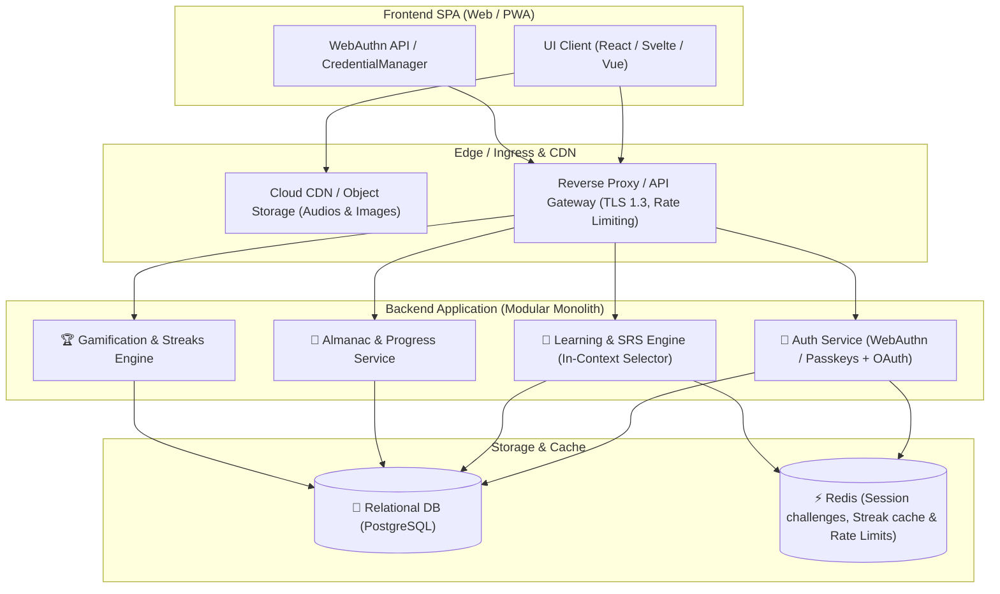

# 🏗️ Arquitectura General del Backend — Vocabulary App

> **Versión**: 1.0 (Draft Arquitectónico Inicial)  
> **Fecha**: 2026-11-15  
> **Rol**: Senior Backend Architect  
> **Basado en**: [vocabulary-app-requirements.md](../../requirements/vocabulary-app-requirements.md) y [initial-business-rules.md](../../requirements/business-rules/initial-business-rules.md)

---

## 1. Visión y Desafíos Arquitectónicos

El backend de la aplicación debe dar soporte a una experiencia de aprendizaje continuo, de baja latencia y alta interactividad. Los 4 pilares técnicos fundamentales son:

1. **Autenticación Passwordless Nativa (Passkeys / WebAuthn FIDO2)**:
   - Registro y login sin contraseñas locales mediante desafíos criptográficos asimétricos (public-key cryptography).
   - Canal de soporte fallback (OAuth2 / Magic Links).
2. **Motor de Repetición Espaciada Implícita (In-Context Spaced Repetition)**:
   - Grafo de palabras y oraciones contextuales que selecciona inteligentemente palabras a repasar integrándolas en el contenido nuevo.
3. **Persistencia del Almanaque y Gamificación**:
   - Estados de palabra (`Descubierta`, `En Consolidación`, `Dominada`).
   - Gestión de rachas diarias (*Streaks*) con normalización de huso horario del usuario.
   - Sistema de logros y eventos semanales (*Weekly Recap*).
4. **Entrega Ultrarrápida de Assets Multimedia**:
   - Audios nativos e imágenes inequívocas servidas con latencia mínima (<150ms).

---

## 2. Diagrama de Arquitectura de Alto Nivel

---

## 3. Propuesta de Stack Tecnológico

| Capa | Opción Recomendada | Justificación Técnica |
|---|---|---|
| **Runtime & Lenguaje** | **Node.js (TypeScript)** | Ecosistema unificado con el workspace actual (`TypeScript`), librerías oficiales de WebAuthn (`@simplewebauthn/server`) de referencia en la industria y alta concurrencia I/O. |
| **Framework Web** | **Fastify** o **NestJS** | *Fastify*: ultra-ligero, mínimo overhead de latencia (<10ms). *NestJS*: modularidad enterprise y arquitectura limpia por capas. |
| **Base de Datos Principal** | **PostgreSQL (v15+)** | Consistencia transaccional para progreso de palabras, tipos de datos nativos (JSONB, Arrays) y extensiones avanzadas para queries de búsqueda y grafos. |
| **ORM / Query Builder** | **Prisma ORM** | El esquema implementado ya adoptó Prisma; aporta cliente tipado y migraciones declarativas versionadas. |
| **Caché & Volátiles** | **Redis** | Almacenamiento efímero de *challenges* criptográficos WebAuthn (con TTL estricto de 60s), rate limiting y cómputo de rachas. |
| **Media & Storage** | **S3-compatible (Cloudflare R2 / AWS S3) + CDN** | Almacenamiento de audios (MP3/Opus) e imágenes WebP sin costo de egress ni impacto en el servidor de aplicación. |

---

## 4. Próximos Entregables del Backend

- [ ] **Modelo de Datos Relacional Completo (ERD)** (`docs/design/backend/data-model/erd.md`).
- [ ] **Especificación de Autenticación Passkeys (FIDO2/WebAuthn)** (`docs/design/backend/security/webauthn-spec.md`).
- [ ] **Catálogo de Endpoints RESTful y DTOs** (`docs/design/backend/api/api-spec.md`).
- [ ] **Algoritmo del Motor de Repetición Espaciada Implícita**.
