# 🗄️ Modelo de Datos Lógico (ERD) — Vocabulary App

> **Versión**: 1.0  
> **Motor Objetivo**: PostgreSQL  
> **Fecha**: 2026-11-15  

---

## 1. Diagrama Entidad-Relación (Mermaid)

```mermaid
erDiagram
    USER ||--o{ PASSKEY_CREDENTIAL : owns
    USER ||--o{ USER_WORD_PROGRESS : tracks
    USER ||--o{ USER_STREAK_LOG : logs
    USER ||--o{ USER_ACHIEVEMENT : unlocks

    CATEGORY ||--o{ WORD : classifies
    WORD ||--o{ SENTENCE_WORD : "appears in"
    SENTENCE ||--o{ SENTENCE_WORD : contains

    USER ||--o{ WEEKLY_RECAP : receives

    USER {
        uuid id PK
        string email UK "nullable si usa solo passkey con userHandle"
        string display_name
        string estimated_level "A1, A2, B1, B2, C1"
        string timezone "Default UTC"
        timestamp created_at
        timestamp updated_at
    }

    PASSKEY_CREDENTIAL {
        string credential_id PK
        uuid user_id FK
        bytea public_key
        bigint counter
        string device_type
        boolean backed_up
        timestamp created_at
        timestamp last_used_at
    }

    CATEGORY {
        string slug PK "e.g. technology, office, fruits"
        string name "Nombre visible"
        string description
        string icon_url
        integer display_order
    }

    WORD {
        uuid id PK
        string slug UK
        string term_en "Palabra en inglés"
        string translation_es "Traducción al español"
        string phonetic_ipa "/.../"
        string audio_url "CDN path"
        string image_url "CDN path inequívoca"
        string category_slug FK
        integer difficulty_score "1 a 10"
        timestamp created_at
    }

    SENTENCE {
        uuid id PK
        string sentence_en "Oración en inglés"
        string translation_es
        string audio_url
    }

    SENTENCE_WORD {
        uuid sentence_id PK,FK
        uuid word_id PK,FK
        boolean is_target_word
    }

    USER_WORD_PROGRESS {
        uuid id PK
        uuid user_id FK
        uuid word_id FK
        string state "DISCOVERED, CONSOLIDATING, MASTERED"
        integer direct_success_count "Aciertos en juego directo"
        integer context_success_count "Aciertos en oraciones de repaso implícito"
        timestamp next_review_at "Calculado por SRS"
        timestamp last_practiced_at
        timestamp discovered_at
    }

    USER_STREAK_LOG {
        uuid id PK
        uuid user_id FK
        date activity_date "Normalizada según user.timezone"
        integer words_practiced_count
    }

    ACHIEVEMENT {
        string code PK "e.g. STREAK_7_DAYS, TECH_MASTER"
        string title
        string description
        string badge_icon_url
    }

    USER_ACHIEVEMENT {
        uuid user_id PK,FK
        string achievement_code PK,FK
        timestamp unlocked_at
    }

    WEEKLY_RECAP {
        uuid id PK
        uuid user_id FK
        date week_start_date
        date week_end_date
        jsonb summary_data "palabras nuevas, dominadas, precisión"
        timestamp generated_at
    }
```

---

## 2. Decisiones de Integridad e Índices Clave

1. **`USER_WORD_PROGRESS (user_id, word_id)`**:
   - `UNIQUE CONSTRAINT`: Un usuario solo tiene un registro de progreso por palabra.
   - `INDEX (user_id, next_review_at)`: Vital para que el motor de repaso espaciado implícito extraiga en tiempo constante ($O(1)$) las palabras que deben inyectarse en los ejercicios de hoy.
2. **`SENTENCE_WORD (word_id)`**:
   - `INDEX (word_id)`: Permite encontrar rápidamente oraciones de ejemplo que reutilicen una palabra específica pendiente de repaso.
3. **`USER_STREAK_LOG (user_id, activity_date)`**:
   - `UNIQUE CONSTRAINT`: Una sola entrada por día calendario del usuario. Previene duplicidad en el conteo de rachas.
