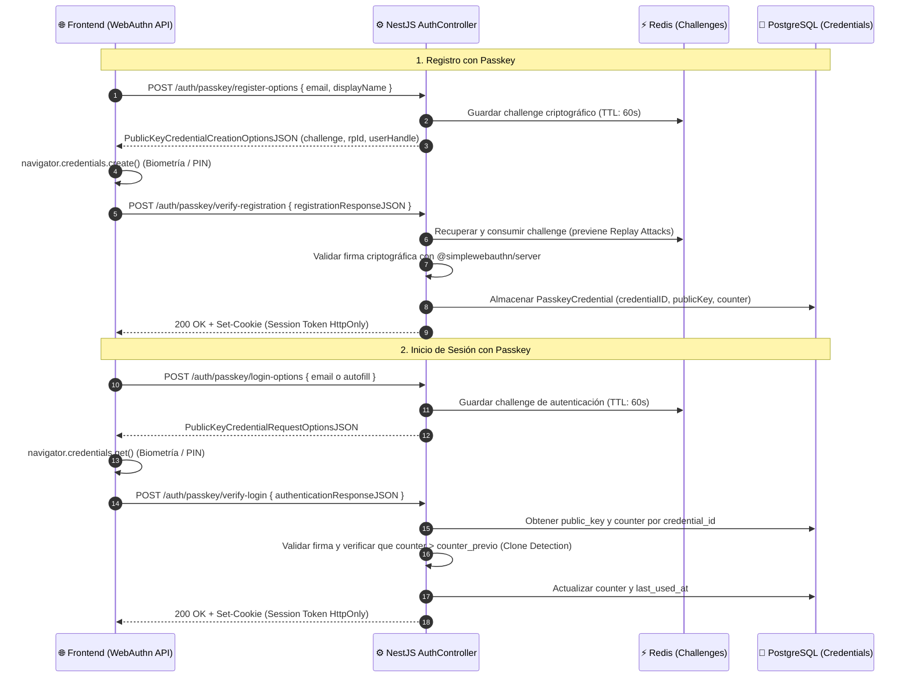

# 🔐 Especificación de Autenticación y Seguridad — Passkeys (WebAuthn) + OAuth2 Fallback

> **Versión**: 1.0  
> **Fecha**: 2026-11-15  
> **Framework**: NestJS (`AuthModule`)  
> **Librerías de referencia**: `@simplewebauthn/server`, `@nestjs/passport`, `passport-google-oauth20`

---

## 1. Visión General de la Estrategia de Autenticación

El sistema implementa una arquitectura **Passwordless First**:
1. **Canal Primario**: **Passkeys (FIDO2 / WebAuthn)** mediante biometría nativa del dispositivo (FaceID, TouchID, Windows Hello, huella Android).
2. **Canal de Respaldo (Fallback)**: **OAuth2 Social Login** (Google / GitHub) para dispositivos o navegadores sin autenticadores compatibles.
3. **Manejo de Sesión**: Cookies de sesión firmadas `HttpOnly`, `Secure`, `SameSite=Strict` con tokens JWT rotativos y sesión indexada en Redis.

---

## 2. Flujo Criptográfico de Passkeys (WebAuthn)

---

## 3. Flujo de Respaldo OAuth2 (Google)

1. `GET /api/v1/auth/oauth/google`: Redirecciona al consent screen de Google con `state` anti-CSRF temporal guardado en Redis.
2. `GET /api/v1/auth/oauth/google/callback`:
   - Valida el `code` y el `state`.
   - Extrae el perfil verificado (`email`, `googleId`, `name`).
   - Si el usuario existe, inicia sesión. Si es nuevo, provisiona la cuenta en PostgreSQL.
   - Emite la misma cookie de sesión `HttpOnly` y redirige al dashboard.
   - Ofrece al usuario vincular una Passkey en su dispositivo actual para futuros inicios de sesión con un solo toque.

---

## 4. Matriz de Mitigaciones de Seguridad (OWASP Top 10)

| Vector de Ataque | Mitigación Implementada |
|---|---|
| **Replay Attacks (Passkeys)** | Cada *challenge* criptográfico tiene un TTL estricto de 60 segundos en Redis y es eliminado inmediatamente tras su primer uso (*single-use nonce*). |
| **Clonación de Credenciales** | Detección de incremento en el `counter` de WebAuthn: si un autenticador envía un contador menor o igual al registrado en base de datos, el backend bloquea la credencial por sospecha de clonación de hardware. |
| **CSRF (Cross-Site Request Forgery)** | Cookies de sesión configuradas con `SameSite=Strict`, `Secure` (HTTPS obligatorio) y `HttpOnly` (inaccesibles por JavaScript frontend, mitigando XSS). |
| **Fuerza Bruta y DoS** | Rate limiter distribuido por IP y por endpoint sensible mediante Redis (`@nestjs/throttler`): máximo 5 intentos por minuto en generación de challenges. |
| **Inyección de Entrada** | Validación estricta con DTOs en NestJS usando `ValidationPipe({ whitelist: true, forbidNonWhitelisted: true })`. |
