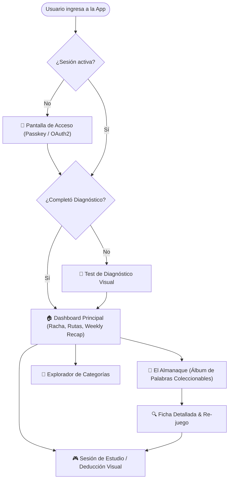

# 🗺️ Mapa de Navegación y Arquitectura Frontend — Vocabulary App

> **Versión**: 1.0  
> **Rol**: Senior Frontend Architect & Accessibility Lead  
> **Alineado con**: Requerimientos ([vocabulary-app-requirements.md](../../requirements/vocabulary-app-requirements.md)) y Contratos Backend ([api-spec.md](../backend/api/api-spec.md))  

---

## 1. Visión y Principios del Frontend
La experiencia de usuario debe ser **fluida (60 FPS), inmersiva, táctil y de fricción cero**:
1. **Passkeys One-Tap**: Registro e ingreso sin teclear contraseñas (utilizando WebAuthn Conditional UI / Autofill nativo).
2. **Aprendizaje Visual Inmersivo**: El centro de atención es la imagen inequívoca y la pronunciación nativa; la interfaz no debe verse sobrecargada.
3. **Coleccionismo Lúdico (El Almanaque)**: El usuario debe sentir la satisfacción de llenar un "álbum de cromos" con estados visuales claros (`Descubierta`, `En Consolidación`, `Dominada`).
4. **Accesibilidad Universal (WCAG 2.2 AA)**: Contraste adecuado, áreas táctiles ≥44x44px, navegación por teclado total y soporte de audio con transcripción fonética para personas con debilidad auditiva.

---

## 2. Flujo de Navegación Global

---

## 3. Inventario de Vistas Principales

| Vista | Ruta | Propósito | Requerimientos Asociados |
|---|---|---|---|
| **AuthView** | `/auth` | Registro y login passwordless con Passkeys (WebAuthn) y Google OAuth2 fallback. | RF-001, RNF-001 |
| **DiagnosticView** | `/onboarding/diagnostic` | Test de 6-8 micro-retos visuales para determinar nivel base objetivo. | RF-002 |
| **DashboardView** | `/` | Centro neurálgico: indicador de racha diaria, ruta recomendada, acceso a categorías y banner de Weekly Recap. | RF-010, RF-011, RF-012 |
| **StudySessionView** | `/learn/:categorySlug?` | Micro-juego inmersivo: imagen inequívoca, audio nativo, deducción y oración de contexto (repaso implícito). | RF-003, RF-004, RF-005, RF-007 |
| **AlmanacView** | `/almanac` | Colección viva tipo álbum de cromos con filtros (`Descubierta`, `En Consolidación`, `Dominada`). | RF-006, RF-008 |
